# moon_vegalite

[中文说明](README.zh.md)

A spec-driven [Vega-Lite](https://vega.github.io/vega-lite/) renderer written in MoonBit.
A Vega-Lite JSON specification goes in; a backend-neutral **scenegraph** and an **SVG** string come out.
It runs on the `wasm-gc`, `js` and `native` backends; the library packages use the MoonBit core library and, for the hand-drawn style,
[moon_rough](https://github.com/sayoi7799/moon_rough) (a port of rough.js); only the `vl2svg` tool uses `moonbitlang/x`, to read and write files.

## Quick start

A Vega-Lite specification (JSON text) in, an SVG document out
([`examples/hello`](examples/hello), a complete project you can run):

```moonbit
let spec : String =
  #|{
  #|  "data": {"values": [{"a": "A", "b": 28}, {"a": "B", "b": 55}, {"a": "C", "b": 43}]},
  #|  "mark": "bar",
  #|  "encoding": {
  #|    "x": {"field": "a", "type": "nominal"},
  #|    "y": {"field": "b", "type": "quantitative"}
  #|  }
  #|}

fn main {
  let svg = @moon_vegalite.render_svg(spec) catch {
    e => {
      println("error: " + e.message())   // names the JSON path of an unsupported feature
      return
    }
  }
  println(svg)
}
```

```sh
git clone https://github.com/sayoi7799/moon_vegalite
cd moon_vegalite/examples/hello
moon run cmd > bar.svg                     # open bar.svg in a browser
```

The same chart from the command line, with the `vl2svg` tool of this repository:

```sh
cd moon_vegalite
moon run cmd/vl2svg --target native -- examples/bar_basic.vl.json bar.svg   # SVG file (stdout without the second argument)
moon run cmd/vl2svg --target native -- --scene examples/bar_basic.vl.json   # scenegraph JSON, with the bounds of every item
```

The library API (`moon_vegalite.mbt`):

```moonbit
let svg = @moon_vegalite.render_svg(spec_json)        // SVG document
let c = @moon_vegalite.compile(spec_json)             // scenegraph + view metadata
let scene = @moon_vegalite.scene_json(c)              // the scenegraph as JSON
```

### Installation

Requirements: the [MoonBit toolchain](https://www.moonbitlang.com/download/) (developed and tested with `moon 0.1.20261016`).

The module `sayoi7799/moon_vegalite` is not on mooncakes.io yet, so it is used from a local checkout through a
`moon.work` workspace. In your own module (see [`examples/hello`](examples/hello) for the whole layout):

```
// moon.mod
import {
  "sayoi7799/moon_vegalite@0.1.0",
}
```

```
// moon.work, next to your moon.mod
members = [
  ".",
  "../moon_vegalite",   // the checkout
]
```

```
// your package's moon.pkg
import {
  "sayoi7799/moon_vegalite",
}
```

Repositories: [GitHub](https://github.com/sayoi7799/moon_vegalite) · [GitLink](https://gitlink.org.cn/sayoi7799/moon_vegalite).

## Hand-drawn style

The shapes of a chart can be drawn by [moon_rough](https://github.com/sayoi7799/moon_rough), a MoonBit port of rough.js 4.6.6: the
rectangles, lines, paths and symbols become sketchy, hatched, hand-drawn shapes, **text stays exactly as it is**.

```moonbit
let svg = @moon_vegalite.render_svg_sketch(
  spec_json,
  options=@moon_vegalite.SketchOptions::new(seed=42, roughness=1.5, fill_style=CrossHatch),
)
```

```sh
vl2svg --sketch --seed 42 --roughness 1.5 spec.vl.json chart.svg      # also --decimals 2 for a smaller file
```

`SketchOptions`: `seed`, `roughness`, `bowing`, `fill_style` (`Hachure` by default, `Solid`, `Zigzag`, `CrossHatch`, `Dots`, `Dashed`,
`ZigzagLine`), `hachure_gap`, `fill_weight` and `fixed_decimals` (rounds the coordinates, which makes the SVG much smaller).

| Scenegraph shape | Drawn by rough as |
| --- | --- |
| `rect` (bars, cells, legend swatches) and the frame of a plot | `rectangle` |
| `rule` (axis lines, ticks, grid lines, rule marks) | `line` |
| `line`, `area`, `symbol` (points, circles, squares, ...) | `path`, with the transform of the symbol kept |
| `text` | not touched |
| gradient fills (continuous colour legends), the page background | not touched |

A shape that has a fill but no stroke (a bar) gets an outline in the colour of its fill. Opacity is kept.

**Reproducible.** The same specification and `seed` give the same bytes, on `js`, `wasm-gc` and `native`. Every shape gets a seed of its
own, a hash of the base seed and the position of the shape in the scenegraph (item, mark, item, ...), in `[1, 2^31-2]`: the bars do not
all wobble alike, and adding or removing a data point does not change the other shapes. The output is tested against the official
packages: for 16 cases (bars, layers, symbols of every shape, areas, arcs, MoonFrame, other fill styles, roughness, bowing, hachure gap and
weight, rounding) the SVG equals what vega-lite 5.23.0 + vega 5.33.1 + rough.js 4.6.6 give (`scripts/lib/sketch.mjs`,
`fixtures/sketchcases`), byte for byte; so do all 32 charts of the [gallery](gallery/index.html), which shows every chart in the three versions.
The [online demo](https://sayoi7799.github.io/moon_vegalite/) has a hand-drawn switch with a seed and a roughness slider.

## Online demo

**<https://sayoi7799.github.io/moon_vegalite/>** — edit a Vega-Lite specification and see this library's SVG (compiled to
JavaScript, running in your browser) next to the official vega-embed rendering, with a badge that says whether the two SVG
texts are identical. Examples include official and layered charts, specifications generated by MoonFrame, and a few
unsupported features, which show their error with the JSON path. The page is built by `.github/workflows/pages.yml`
from [`site/`](site) and the `web` package (`moon build --target js --release`); to run it locally:

```sh
moon build --target js --release
node scripts/build_site.mjs && node scripts/serve_site.mjs     # http://localhost:8080/
```

## From a CSV file with MoonFrame

[`examples/moonframe_demo`](examples/moonframe_demo) reads a CSV with [MoonFrame](https://github.com/ihb2032/MoonFrame),
summarises it, lets MoonFrame generate the Vega-Lite specification and renders it to SVG with this library, all in one
MoonBit program and without the Vega editor. The three SVG files it writes are identical to the official vega output.
MoonFrame 0.7.0 needs a small setup step with the current toolchain, which the demo's `setup.sh` performs and its README explains.

## Feeding errors back to a language model

Models often answer with Vega-Lite that is wrong or uses unsupported features, and the errors of this library start with the
JSON path of the offending property. [`examples/llm_feedback`](examples/llm_feedback) takes recorded model replies (no API key,
no network): a reply that renders becomes an SVG, one that fails becomes a correction prompt with the JSON path and the reason,
ready to be sent straight back to the model.

## Side by side with the official output

Left: this library. Middle: vega-lite 5.23.0 + vega 5.33.1; apart from the accessibility attributes the SVG text is identical. Right: the hand-drawn style (see below).
Open [`gallery/index.html`](gallery/index.html) directly in a browser (no server needed) for all 32 charts, each in the three versions.

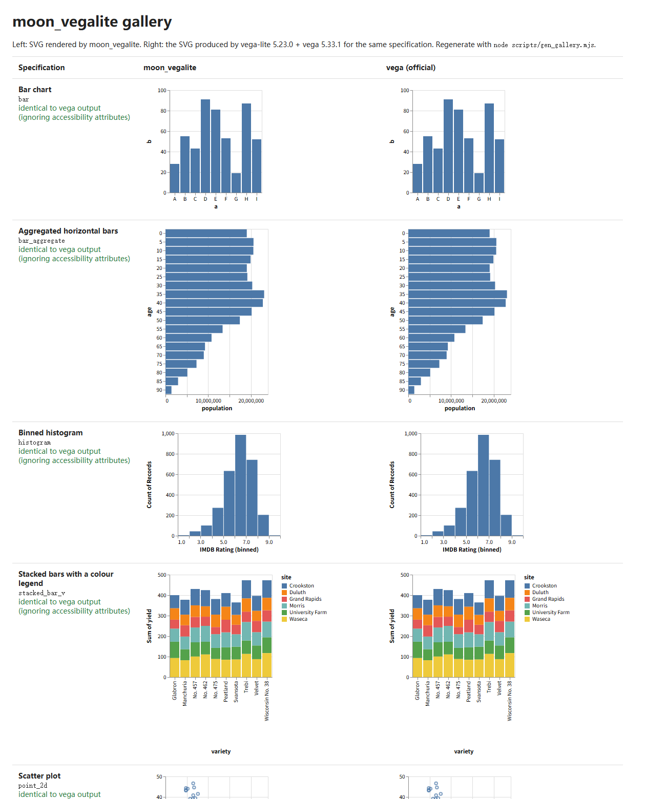

| Chart | moon_vegalite | official vega | hand-drawn |
| --- | --- | --- | --- |
| `stacked_bar_v` | 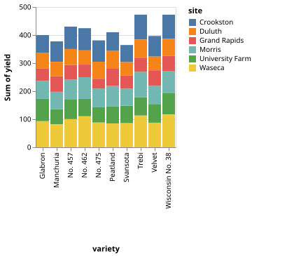 |  | 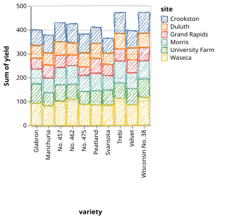 |
| `point_color` | 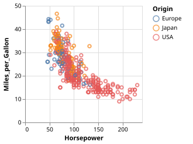 |  | 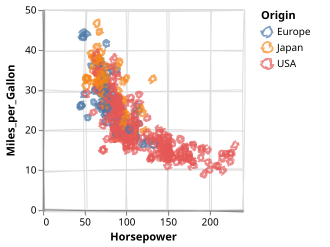 |
| `layer_bar_line` | 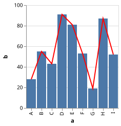 |  | 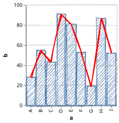 |
| `layer_histogram` | 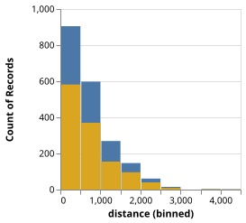 |  | 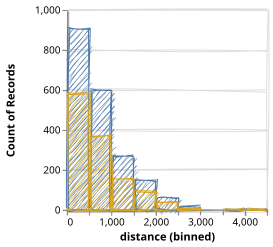 |
| `layer_color_legend_left` | 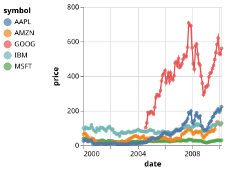 |  | 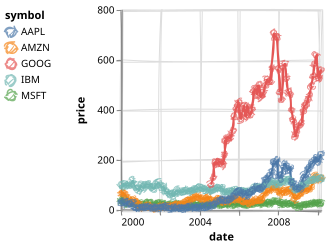 |
| `layer_circle_independent_color` | 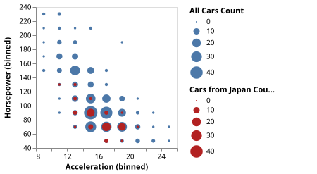 |  | 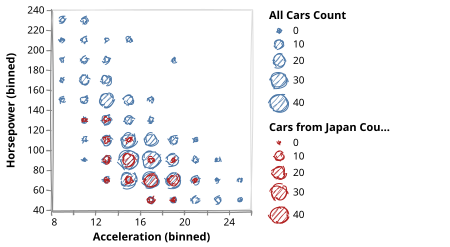 |

## Positioning and differences from other charting libraries

* **It follows Vega-Lite, not a new grammar.** The goal is the same picture the reference implementation draws
  (vega-lite 5.23.0 + vega 5.33.1), not a similar one: axis ticks, label formats, legends, layout and mark bounds are ported
  from vega-lite / vega, including their JavaScript number and text-measurement quirks.
* **Scenegraph first.** Like Vega, the library produces a tree of marks and items with computed bounds. SVG is one renderer
  of that tree; other backends can consume it. Most MoonBit charting code draws directly; here the intermediate form is public.
* **Specifications in, pictures out.** Charts are data (JSON), so they can come from other tools. The test-suite feeds specs
  generated by [MoonFrame](https://github.com/ihb2032/MoonFrame) (`DataFrame` → Vega-Lite) to the renderer.
* **No browser, no JavaScript runtime.** Rendering is a pure function, usable in a native CLI, in WebAssembly, or in JS.
* **Honest about scope.** It is a subset renderer. Anything outside the subset fails with an error that names the JSON path
  (`encoding.color.condition 暂不支持`) instead of drawing something different.

## Support

What is implemented. Anything else raises an error that names the JSON path (`encoding.color.condition 暂不支持`, `mark.tooltip 暂不支持`),
including a property of something that is supported: nothing is silently ignored (`vl/validate.mbt`, `vl/errors_test.mbt`).

| Area | Supported |
| --- | --- |
| Data | inline `data.values`. `data.url` and `datasets` are not read, `data.format.parse` is rejected: embed the values |
| Marks | `bar`, `line`, `point`, `circle`, `square`, `area`, `rule`, `tick`, `rect`, `text`, `arc` |
| Mark properties | `color`, `filled`, `opacity`, `interpolate` (`linear`, `step`, `step-before`, `step-after`, `monotone`); `size` for `rule` and `line` (the stroke width); `rule`: `strokeDash`; `text`: `align`, `baseline`, `dx`, `dy`, `fontSize`, `text`, `x`, `y` (`"width"` / `"height"` or pixels); `arc`: `innerRadius`, `outerRadius`, `padAngle`, `cornerRadius`, `stroke`, `strokeWidth` |
| Position channels | `x`, `y` (a field, or a numeric `datum`), `x2`, `y2` (on `rule`, `bar`, `rect`: ranged bars and rects, rules across the plot), `theta` (on `arc`) |
| Other channels | `color` (nominal fields with the category scheme, ordinal fields with a blues ramp sampled per value, quantitative fields with a blues ramp and a gradient legend, constant values), `size`, `opacity` (also constant), `shape` (nominal), `text` (with `format`); `aggregate: count` without a field works on size, colour, opacity and shape |
| Field types | `quantitative`, `ordinal`, `nominal`, `temporal` |
| Aggregates | `count`, `sum`, `mean`, `average`, `min`, `max`, `median`, `distinct`, … (the vega aggregate ops) |
| Transforms | `filter` (expression or predicate), `calculate` (expression subset), `aggregate`, `bin`, `timeUnit`, `fold`; field-level `bin`, `timeUnit`, `aggregate` |
| Time units | year, quarter, month, week, date, day, hours, minutes, seconds, milliseconds and combinations (UTC; "local" time is UTC) |
| Scales | `linear`, `log`, `sqrt`, `pow`, `time`, `utc`, `band`, `point`, `ordinal` with `domain`, `domainMin`, `domainMax`, `range`, `zero`, `nice`, `reverse`, `clamp`, `base`, `exponent` (position channels); the angle scale of `arc` takes `range` |
| Stacking | default stacking for `bar` and `area` (stacked areas are imputed, as vega-lite does); `stack: zero / center / normalize / null`; `arc` stacks `theta` around the circle (`zero`, `normalize`) |
| Sorting | `sort` on discrete x / y: `ascending`, `descending`, a value list, `-x` / `-y`, `{op, field, order}` |
| Axes | grid, ticks, labels with flush / overlap removal, title; the properties `domain`, `grid`, `labels`, `ticks`, `format`, `labelAngle`, `labelFlush`, `labelOverlap`, `tickMinStep`, `titlePadding`, `offset`, `position` and the colour / width / size family; `axis: null` |
| Legends | symbol legends (size, shape, opacity, colour, merged when the channels share a field), gradient legend for quantitative colour (the default blues ramp); `legend.orient`: `left` or `right`; `legend: null` |
| Layers | `layer` with nested layers and inherited `data` / `transform` / `encoding`; position scales shared by default (domains merged, a band scale wins over a point scale) or independent with `resolve.scale.x / y` (each with its own axis, the second on the opposite side); colour scales and legends shared, or independent with `resolve.scale.color`; one size scale with independent legends (`resolve.legend.size`); layers that bin the same field identically share one bin and one binned scale; axis and legend titles merge as in vega-lite |
| Arcs | `mark: arc` with `theta` and `color`: pie and donut charts, in a 200 × 200 view without a frame |
| Layout | one view or `layer`; `width` / `height` as numbers or `{step}`; `padding`; `background`; a single-string `title` |
| Hand-drawn style | `render_svg_sketch` / `vl2svg --sketch`: rects, rules, lines, areas, symbols, arcs and plot frames drawn by moon_rough, text unchanged (see above) |
| Config | `config.scale.zero` only; every other `config` key is rejected with its path |
| Accepted, no effect on the picture | `description`, `name`, `usermeta` |

Not supported, each raising an error with its path: interaction (`params`, `selection`, `tooltip`, `condition`), `projection` and geo marks,
`facet`, `concat` (`hconcat` / `vconcat`), `repeat`, `autosize`, a title given as an object, the `radius` / `theta2` channels and polar text, `trail`,
`boxplot`, `errorbar`, `errorband`, the transforms `window`, `joinaggregate`, `flatten`, `loess`, `regression`, `density`, `pivot`, `lookup`
and the full Vega expression language (only the subset `calculate` and `filter` need), the scale types `symlog`, `quantile`, `quantize`,
`threshold`, `bin-ordinal` and `sequential` and scale options (`scheme`, `range`) on non-positional channels, any `config` except
`scale.zero`, and axis / legend options that are not listed above.

## Accuracy against the official implementation

Every expected value in the tests comes from the official packages, never from this repository:

| Layer | Reference | Where |
| --- | --- | --- |
| number formatting, ticks, `nice`, time formats, scales | d3 / vega-format / vega-scale as bundled in vega 5.33.1 | `fixtures/{numfmt,ticks,formatcases,timecases,scalecases}` |
| expressions, data transforms | vega-expression, vega-transforms | `fixtures/{exprcases,transformcases}` |
| scenegraph bounds, SVG | vega-scenegraph | `fixtures/scenecases` |
| **end to end: 80 official Vega-Lite examples (15 of them `layer_*`, 2 of them `arc_*`), edge cases, MoonFrame specs** | vega-lite 5.23.0 compile + vega scenegraph and SVG | `fixtures/vlexamples` |

For the end-to-end cases the scenegraph (every mark, item property and bounds, numbers within a relative `1e-9`) and the
SVG text (exactly, ignoring only the accessibility `role` / `aria-label` attributes) must equal the official output.
The cases cover the 80 official examples listed in `examples/official.txt`, the edge cases in `examples/edge_*.vl.json`, the channel specs in `examples/channel_*.vl.json`
(empty data, all-null column, single-value domain, log scale with non-positive values), and six charts generated by MoonFrame
(`examples/moonframe`). Invalid JSON and unsupported features are covered by `vl/errors_test.mbt`.

`moon test` passes on `wasm-gc`, `js` and `native`.

### Fixture provenance and regeneration

Fixtures are MoonBit files generated by `scripts/gen_fixtures.mjs` with the versions pinned in `scripts/package-lock.json`
(vega-lite 5.23.0, vega 5.33.1, vega-datasets 3.2.1) on Node.js 24 (some expected values depend on V8's `Math` functions, so the Node major version matters). The process time zone is fixed to UTC.

```sh
cd scripts
npm ci
npm run fixtures            # downloads the example specs of the vega-lite tag, regenerates ../fixtures
npm run gallery             # regenerates ../gallery (needs: moon build --target native cmd/vl2svg)
```

CI regenerates the fixtures and fails if any committed generated file differs.

`util/pow10_table.mbt` holds 10^k for integer k in [-330, 310]. It is generated as `Number("1e" + k)` (the correctly rounded value) and not with `Math.pow(10, k)`: V8 is not consistent about `Math.pow`, which differs by one ulp for a few exponents between Linux, macOS and Windows builds of Node 24 (and for about 70 exponents between Node 22 and 24). `js_pow10` therefore matches V8 on most builds rather than on one particular build. Compared with the Windows build that produced the previous table, only 10^23 changed, and the full test-suite, including the end-to-end comparison with the official output, passes unchanged.

`examples/moonframe/*.vl.json` were produced by `ihb2032/MoonFrame` 0.7.0 (`@chart.format_vega_lite`). MoonFrame 0.7.0 does
not currently build with the latest MoonBit toolchain (its dependencies `NyaCSV` and `quickcheck` still ship `moon.mod.json`, and
three `NyaCSV` tests use a removed `Buffer` API), so the specs were generated in a scratch project after migrating those
manifests and removing the three tests locally. The generated JSON is committed unchanged.

## Performance

Two scenarios, the same specification for every column (generated by `benchmarks/data.mbt`; `scripts/bench/specs.mjs` implements the same
generator and the test pins checksums computed in JavaScript). Each run starts from the specification text, like `render_svg` does.
"to SVG" is the whole pipeline; "to scenegraph" stops before the SVG text is written. Mean ± standard deviation of 10 batches.

| Scenario | native | js | wasm-gc | Node 24 + vega-lite 5.23.0 + vega 5.33.1 |
| --- | --- | --- | --- | --- |
| 10,000 rows, mean per category, bars: to SVG | 21.5 ± 0.4 ms | 9.5 ± 0.2 ms | 8.6 ± 0.7 ms | 5.9 ± 0.8 ms |
| 10,000 rows, mean per category, bars: to scenegraph | 21.4 ± 0.6 ms | 9.6 ± 0.4 ms | 7.9 ± 0.2 ms | 4.5 ± 0.3 ms |
| 100,000-point scatter plot: to SVG | 1.68 ± 0.03 s | 0.83 ± 0.03 s | 0.68 ± 0.04 s | 0.88 ± 0.04 s |
| 100,000-point scatter plot: to scenegraph | 0.66 ± 0.02 s | 0.32 ± 0.03 s | 0.28 ± 0.03 s | 0.17 ± 0.01 s |

For both scenarios the SVG is identical to the official one (15.8 MB for the scatter plot), checked by `scripts/bench/vega_bench.mjs --check`.

```sh
moon bench --release --target js -p sayoi7799/moon_vegalite/benchmarks        # also wasm-gc and native
moon build --target native cmd/vl2svg                                          # the identical-SVG check runs this binary
cd scripts && npm ci && npm run bench                                          # the vega side, with the identical-SVG check
```

What the numbers say:

* On the small chart, vega on Node is faster (5.9 ms against 8.6 to 9.5 ms for `wasm-gc` and `js`): a warmed-up JIT and no start-up work.
* On the 100,000-point scatter plot `wasm-gc` (0.68 s) and `js` (0.83 s) are as fast as vega on Node (0.88 s) end to end. Building the scenegraph is
  slower than vega's (0.28 to 0.32 s against 0.17 s); writing the SVG is faster (0.40 and 0.52 s against 0.71 s).
* `native` is the slowest, about twice as slow as `wasm-gc` and `js` on this allocation-heavy work. This was only measured, not investigated or optimised.

Measured on one machine (AMD Ryzen 9 7945HX, Windows 11), one run per configuration, `moon 0.1.20261016` in release mode, Node 24.20.0.
The vega side was timed after three warm-up iterations and includes `JSON.parse` of the specification text. Treat the numbers as indications, not as a claim.

## Layout

| Package | Content |
| --- | --- |
| `util`, `stats`, `format`, `time`, `value` | JavaScript-compatible numbers (V8 libm), d3 ticks, d3-format, time intervals / formats, dynamic values |
| `scale` | continuous, band, point, ordinal and sequential scales, colour schemes |
| `expr`, `transform` | the expression subset, aggregate / bin / stack / timeunit / fold / filter / formula |
| `scene`, `svg` | scenegraph, mark bounds, path generation, SVG renderer |
| `spec` | strict reader of Vega-Lite JSON (unsupported features raise errors with paths) |
| `vl` | the compiler: data pipeline, scales, axes, legends, layout |
| `sketch` | the hand-drawn style: the shapes of the scenegraph drawn by moon_rough |
| `web` | the entry point of the demo page (js): `render`, `render_sketch` |
| `benchmarks` | `moon bench` for the performance table (not part of the library) |
| `cmd/vl2svg` | command line tool (native) |

## Development history

Most of the work before 24 October 2026 was done locally, without committing step by step. On 24 October 2026 the
existing code was organised into commits by module (low-level numeric and time libraries, scales, expressions and
transforms, scenegraph and SVG, specification reader, compiler stages, tests, CI). The history on GitHub was rewritten
once at that time, to fold a few follow-up CI fixes into one commit. Since then every change is made on its own branch
for a GitHub issue and merged through a pull request that closes the issue.

## License

Apache-2.0. Parts of the code are ports of vega, vega-lite and d3 (BSD-3-Clause / ISC); see the file headers.
The hand-drawn style depends on [moon_rough](https://github.com/sayoi7799/moon_rough) (MIT), a port of [rough.js](https://github.com/rough-stuff/rough) (MIT).
