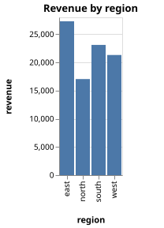
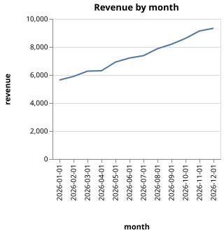
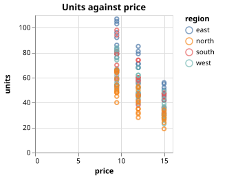

# MoonFrame → moon_vegalite

A CSV file becomes SVG charts without leaving MoonBit and without opening the Vega editor:

```
data/sales.csv ──read_csv──▶ DataFrame ──group_by / agg──▶ DataFrame
                                                              │  ChartSpec::bar / line / point
                                                              ▼
                              Vega-Lite JSON  ◀──format_vega_lite── (MoonFrame)
                                    │
                                    ▼  render_svg (moon_vegalite)
                              out/*.svg
```

[MoonFrame](https://github.com/ihb2032/MoonFrame) reads the CSV, summarises it and writes a Vega-Lite specification
(`format_vega_lite`); this library turns that specification into SVG (`render_svg`). The program is [`cmd/main.mbt`](cmd/main.mbt).

## Run it

```sh
cd examples/moonframe_demo
./setup.sh          # once, see below
moon run cmd
```

It reads `data/sales.csv` (144 rows: month, region, product, price, units, revenue) and writes three charts to `out/`
(the specification MoonFrame generated is next to each SVG, as `*.vl.json`):

| `revenue_by_region.svg` | `revenue_by_month.svg` | `units_vs_price.svg` |
| --- | --- | --- |
|  |  |  |

The three SVG files committed here are byte-identical to what vega-lite 5.23.0 + vega 5.33.1 draw for the same
specifications (ignoring accessibility attributes).

## Why `setup.sh`

MoonFrame 0.7.0 and its dependencies (`NyaCSV`, `quickcheck`) were published for an older MoonBit toolchain and do not
build with the current one as they are:

* they still ship `moon.mod.json`, which the toolchain refuses to load; `moon fmt` inside each dependency migrates it to `moon.mod`;
* three inline tests in `NyaCSV` use the removed `Buffer` API; they test `NyaCSV` itself and are dropped.

`setup.sh` fetches the dependencies, applies those two changes to the copies under `.mooncakes/` and runs `moon check`.
Nothing outside `.mooncakes/` is touched. Once MoonFrame publishes a version that builds, the script is not needed.
For this reason the demo is not part of the repository's CI.

The module uses the library from the checkout through `moon.work` (`members = [".", "../.."]`).
